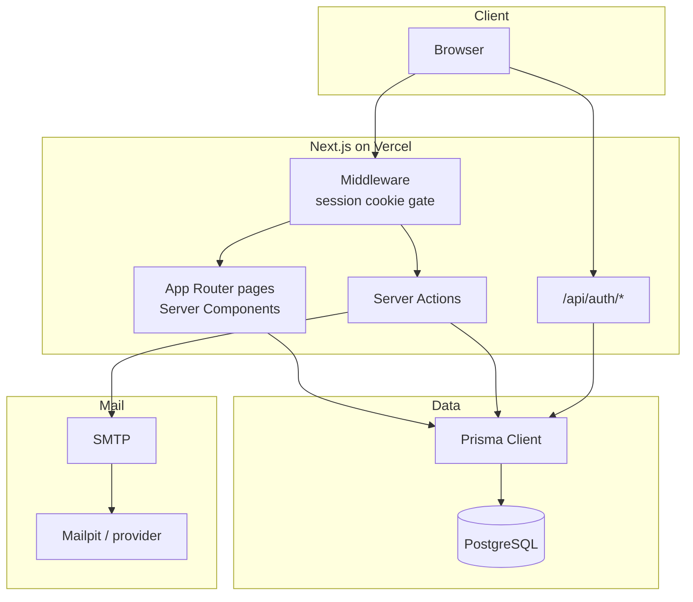
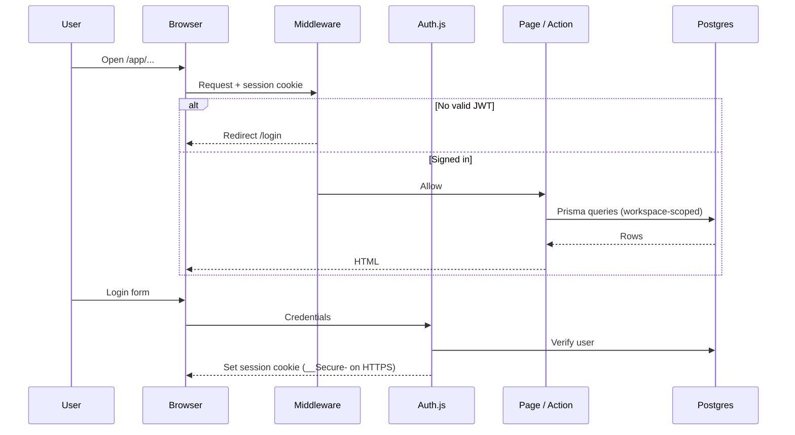
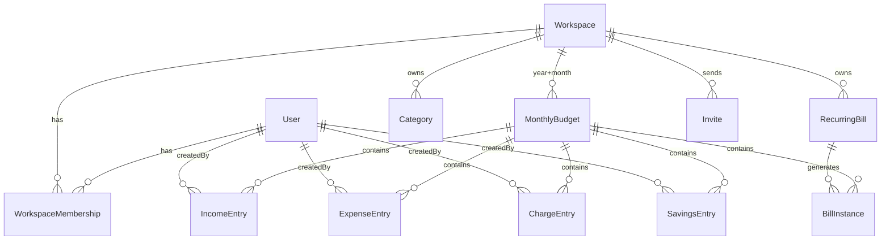
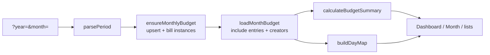
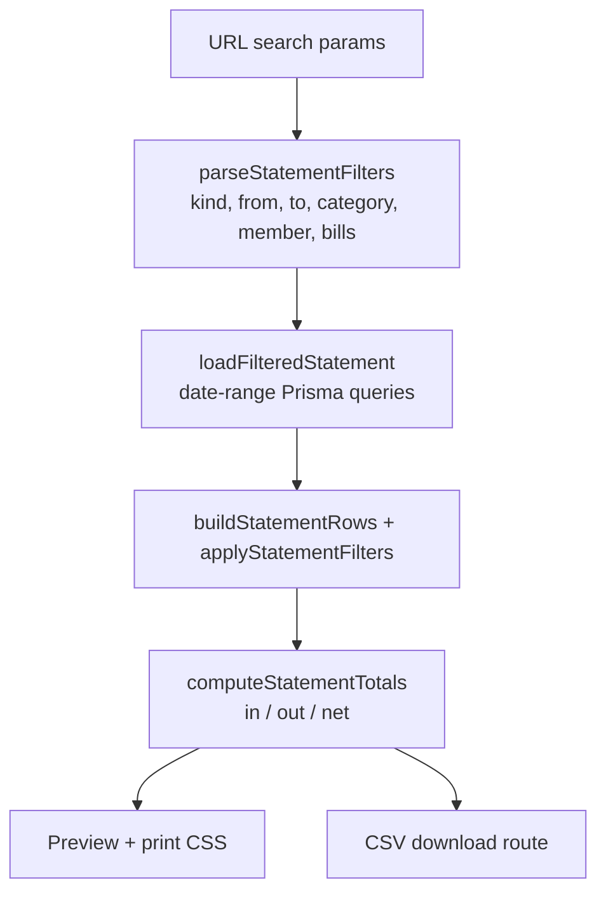
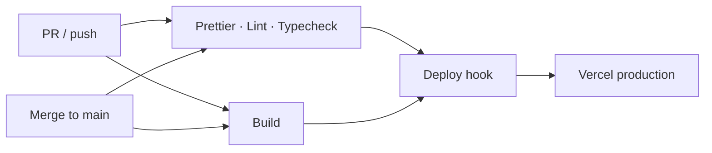

# Hearth

**Household money, kept together.**

Hearth is a multi-member household budget app. A family (or one person) creates a workspace, invites people by email, and tracks each calendar month: money in, fixed bills, day-to-day spend, savings, and charges — with every line attributed to who added it and when. Statements are filterable, printable, and downloadable as CSV.

Production: [hearth-phi-six.vercel.app](https://hearth-phi-six.vercel.app)

---

## How it works (product)

### Workspaces

- **Home** — shared household budget. Money-in is labeled **Funds**.
- **Just you** — personal budget. Money-in is labeled **Income**.

Each workspace has its own currency, members, categories, bills, and month history. Members have roles (owner / admin / member). Invites go out by email; locally they land in Mailpit.

### Month-scoped money

Everything important is tied to a **year + month** (e.g. November 2026 ≠ October 2026):

| Area           | What it tracks                                   |
| -------------- | ------------------------------------------------ |
| Funds / Income | Money available that month                       |
| Expenses       | Day-to-day spending (optional category)          |
| Charges        | One-off hits                                     |
| Savings        | Amounts set aside                                |
| Bills          | Recurring obligations (pending / paid / skipped) |
| Month          | Calendar + list of activity for the period       |
| Dashboard      | Counters, category rollups, recent activity      |
| Statement      | Filtered printable / CSV report                  |
| Alerts         | Due soon, overdue, invites, budget-low           |

Counters recalculate from the month’s rows: income in, spend out (expenses + charges + savings + paid bills), remaining = in − out.

### Attribution

Every money entry stores **who** created it and **when**. Lists, the month calendar, and statements always show that. You can filter expenses / statements by member.

### Statements

On **Statement** you pick a kind and filters; print and CSV use the same rows:

- Kinds: Full · Funds/Income · Monthly spend · Expenses · Charges · Savings · Bills
- Filters: from → to dates, category, member, bill status
- Amounts are signed (+ in / − out); **net = inflow − outflow** (pending bills listed but not counted in net)

---

## How it works (technical)

### Stack

| Layer      | Choice                                            |
| ---------- | ------------------------------------------------- |
| App        | Next.js App Router, React 19, TypeScript          |
| UI         | Tailwind + shadcn/ui-style primitives             |
| Auth       | Auth.js (NextAuth v5) credentials + JWT session   |
| Data       | Prisma 6 → PostgreSQL                             |
| Validation | Zod (+ React Hook Form where needed)              |
| Email      | Nodemailer → SMTP (Mailpit locally)               |
| Deploy     | Vercel (`syd1`) + Supabase Postgres in production |
| Tooling    | pnpm, ESLint, Prettier, GitHub Actions            |

### High-level architecture



### Request and auth flow



Middleware reads the Auth.js cookie (including the `__Secure-` prefix in production) and keeps `/app/*` private.

### Domain model (simplified)



- **Workspace** — `HOME` or `PERSONAL`, slug, currency.
- **MonthlyBudget** — unique per `(workspaceId, year, month)`; all money rows hang off it.
- **BillInstance** — per-month copy of a recurring bill; status drives spend and alerts.
- Money rows require `createdById` for attribution.

### Month load path



Opening a month page upserts that month’s budget, generates any missing bill instances from active recurring bills, then loads entries with creators/categories for UI and counters.

### Statements



Preview and CSV share the same filter parser and row builder so exports always match the screen.

### CI → production

GitHub Actions owns the pipeline end-to-end (Vercel Git auto-deploy is off).

**On every PR / push to `main`:**

1. **Prettier · Lint · Typecheck**
2. **Build** (`build:verify` — generate + `next build`, no migrate)

**On push to `main` only (after both pass):**

3. **Deploy production** — Actions POSTs `VERCEL_DEPLOY_HOOK` (Vercel Deploy Hook for `main`). No personal access token.



**One-time setup:** Vercel → Hearth → **Settings → Git → Deploy Hooks** → create hook for branch `main` → paste the URL into GitHub → **Settings → Secrets → Actions** as `VERCEL_DEPLOY_HOOK`.

Vercel Git auto-deploy stays off (`vercel.json`) so only this CI hook ships production.

Locally: `pnpm check` runs format, lint, typecheck, and `build:verify`.

On Vercel build: `pnpm build` regenerates the Prisma client, runs `migrate deploy` (prefers `DIRECT_URL` / session `:5432`), then `next build`.

---

## Local setup

```bash
# 1. Install
pnpm install

# 2. Env
cp .env.example .env
# Set DATABASE_URL, AUTH_SECRET, AUTH_URL, SMTP_* for local Docker

# 3. Infra
docker compose up -d
# Postgres → localhost:5432
# Mailpit UI → http://localhost:8025

# 4. Schema
pnpm exec prisma migrate dev
pnpm db:seed   # optional demo household

# 5. App
pnpm dev
```

Open [http://localhost:3000](http://localhost:3000).

### Demo seed accounts

| Email               | Password      | Role   |
| ------------------- | ------------- | ------ |
| `arin@hearth.local` | `password123` | Owner  |
| `sam@hearth.local`  | `password123` | Member |

Workspace: `/app/demo-home/dashboard`

### Smoke path

1. Register or use a seed user
2. Create a workspace (or open Demo Home)
3. Invite a second email → open Mailpit at `:8025`
4. Accept the invite as that user
5. Each member adds expenses → filter by member
6. Open Statement → change kind / date range → Print or CSV
7. Add a recurring bill → mark paid → check Alerts

---

## Scripts

| Script            | Purpose                                    |
| ----------------- | ------------------------------------------ |
| `pnpm dev`        | Dev server                                 |
| `pnpm check`      | Prettier + lint + typecheck + build verify |
| `pnpm build`      | Migrate deploy + production Next build     |
| `pnpm start`      | Run production server                      |
| `pnpm typecheck`  | `next typegen` + `tsc`                     |
| `pnpm lint`       | ESLint                                     |
| `pnpm format`     | Prettier write                             |
| `pnpm db:migrate` | Prisma migrate dev                         |
| `pnpm db:seed`    | Seed demo data                             |
| `pnpm db:studio`  | Prisma Studio                              |

---

## Environment (overview)

| Variable       | Role                                                                |
| -------------- | ------------------------------------------------------------------- |
| `DATABASE_URL` | App queries (prod: Supabase transaction pooler `:6543` + pgbouncer) |
| `DIRECT_URL`   | Optional; preferred for `prisma migrate deploy` (session `:5432`)   |
| `AUTH_SECRET`  | Auth.js signing secret                                              |
| `AUTH_URL`     | Canonical app URL                                                   |
| `SMTP_*`       | Invite email (Mailpit locally)                                      |

See [`.env.example`](./.env.example) for full templates.

---

## Docs

- [`docs/FEATURES.md`](./docs/FEATURES.md) — product + architecture spec
- [`docs/COMMIT_PLAN.md`](./docs/COMMIT_PLAN.md) — delivery / branch map
- [`docs/DESIGN.md`](./docs/DESIGN.md) — design system notes

---

## License

Private project — all rights reserved unless otherwise stated.
